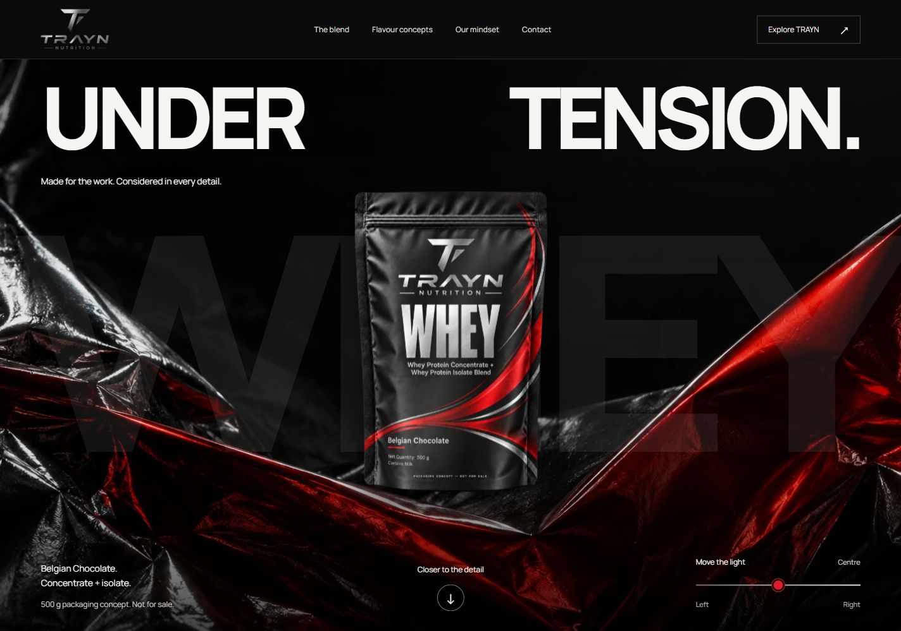

# TRAYN Under Tension

A non-selling product showcase using TRAYN’s existing approved identity and packaging concepts. **Under Tension** is the selected direction for the main rebuild. All three opening studies remain preserved as independent drafts in `prototypes/openings/` and are included in the same deployment at `/drafts/`. Built separately from `../traynnutrition-website-v2`; that source website and Shopify theme remain unchanged.



See [the current implementation and verification record](docs/UNDER_TENSION.md). After deployment to the configured repository, the standard Pages comparison address is [acoaria4.github.io/traynnutrition3/drafts/](https://acoaria4.github.io/traynnutrition3/drafts/). This is the expected deployment address, not a claim that the latest changes are published.

## Run locally

Requires Node.js 20.19+ or 22.12+ (verified with Node 24.15.0).

```sh
npm ci
npm ci --prefix prototypes/openings
npm run dev
```

The dev server prints its local URL. Production:

```sh
npm run build
npm run preview -- --port 4174
```

`npm run build` builds the main site, builds the independent opening studies, then combines their static output in `dist/`. The comparison is at `/drafts/`, with directly shareable `/drafts/quiet.html`, `/drafts/tension.html` and `/drafts/flavour.html`. Each retains its own styling, images and interactions. Domain-root and repository-subdirectory hosting are supported. Vite preview is a local review server, not a production server.

For focused development, `npm run build:main` builds only the main site and `npm run build:drafts` builds only `prototypes/openings/dist/`. Use the combined `npm run build` for deployment. The root dev server serves the main site; run `npm --prefix prototypes/openings run dev` to work on the comparison separately.

## GitHub Pages

The site can run on GitHub Pages; it needs no server-side runtime. The included `.github/workflows/pages.yml` installs both packages using their committed lockfiles, runs source/catalogue/path checks, builds the main site and all retained drafts, verifies built HTML/CSS destinations, and deploys the combined `dist/` when the repository's default branch is pushed. It also supports a manual run from the Actions tab.

1. Push the project source, both `package-lock.json` files, `public/` assets, `prototypes/openings/` source/assets/licences and workflow to the GitHub repository.
2. In the repository, open **Settings → Pages → Build and deployment → Source**, and select **GitHub Actions**.
3. Run **Deploy website to GitHub Pages** from the Actions tab on the default branch, or push another commit to that branch.
4. Use the deployment URL shown by the workflow. GitHub's Pages metadata automatically supplies the right base path for `https://OWNER.github.io/REPOSITORY/`, an account site, or a configured custom domain.

The workflow generates HTML rather than committing compiled pages or `dist/`. The eight main page routes, draft comparison and three draft pages are real static files, so direct navigation and reloads work without an SPA fallback. GitHub Pages serves `404.html` for missing paths; it does not use the optional Netlify-style `_redirects` file. The `/product` convenience alias in that file is not available on Pages; use `/product.html` or the full product route.

For a repository site, share `https://OWNER.github.io/REPOSITORY/drafts/` for the comparison, or append `quiet.html`, `tension.html` or `flavour.html` for one direction. `?v=2` opens the comparison on Under Tension; `?v=2&viewport=mobile` also selects its phone preview. On an account site or custom domain, use the same paths beneath the deployment URL without a repository segment.

To reproduce a repository-path build locally in PowerShell:

```powershell
$env:SITE_BASE_PATH = '/traynnutrition3/'
npm run build
npm run preview -- --port 4175
# Open http://127.0.0.1:4175/traynnutrition3/
```

Set `SITE_BASE_PATH` back to `/` before making a normal root build. For a Bash build, use `SITE_BASE_PATH=/traynnutrition3/ npm run build`. Vite's `--base` option is also supported for the main build. Main-site links, responsive images, CSS fonts and enhanced product navigation share the resolved base path. The draft package deliberately uses relative URLs, so its comparison, direct pages and assets travel together beneath any `/drafts/` location.

The concept preview keeps its existing `noindex` and canonical TRAYN-domain metadata. Publishing to Pages does not activate ecommerce or change those content decisions.

Reference: [Vite's GitHub Pages deployment guide](https://vite.dev/guide/static-deploy.html#github-pages) and [GitHub's custom Pages workflows](https://docs.github.com/en/pages/getting-started-with-github-pages/using-custom-workflows-with-github-pages).

## What belongs in Git

Commit source, scripts, tests, both lockfiles, public images/fonts/licences, workflow configuration and authored Markdown documentation. Keep all three draft implementations and the six native generated PNG originals in `prototypes/openings/assets/`; choosing Under Tension does not replace or delete the other studies. The root and prototype `.gitignore` files exclude dependencies, build output, generated HTML, captures, test screenshots/reports, generated Lighthouse HTML/JSON, local environment secrets, Python caches and editor/OS state. Environment examples remain trackable. Ignoring a path does not delete its local files.

## Verify

```sh
npm run check
npm test
npm run test:browser
```

For a browser-free deployment check, run `npm run test:hosting:static -- --base=/` after the combined build, or `--base=/traynnutrition3/` after a matching repository-path build. This verifies all four draft pages plus local HTML/CSS destinations across both sites, including images, fonts, iframe sources and packaging download links. It rejects missing files, links outside the hosting prefix and output symlinks. The Pages workflow runs this check before uploading.

`npm run test:hosting -- --base=/` (or the matching repository prefix) also launches an isolated local static server and checks real routes, 404 responses, assets, product history, draft interactions/comparison links and mobile no-JavaScript content in Chrome. The durable browser checks are separate from the browser-free build verification.

Browser tests use an installed Chrome browser. Set `PLAYWRIGHT_CHROME_PATH` to your Chrome executable if it differs from the Windows default in `playwright.config.js`. An existing production preview can be tested using `PLAYWRIGHT_BASE_URL=http://127.0.0.1:4174` (set the variable with the syntax appropriate to your shell). Otherwise the suite starts its own dev server.

The local environment initially had a Node certificate-chain issue during installation. Using the Windows system trust store (`NODE_USE_SYSTEM_CA=1`) resolved it without disabling TLS verification. This is an environment note, not a required project configuration.

## Authoring

- `src/data/products.js`: intended product facts, concept approval state, image references, null commercial/nutrition fields and route mapping.
- `src/templates.js`: semantic static page components, shared navigation/footer, product gallery, accessible disclosure content and metadata.
- `scripts/render-pages.mjs`: renders all eight HTML pages before dev/build. Edit templates, not generated HTML.
- `scripts/build-site.mjs`: builds the main site and retained prototype package, copying its output to `dist/drafts/` without changing either source tree.
- `scripts/verify-static-hosting.mjs`: checks emitted HTML/CSS destinations below the selected hosting prefix.
- `prototypes/openings/`: the retained Quiet Before, Under Tension and Flavour Study drafts, their original generated imagery, independent package and comparison harness.
- `src/styles.css`: shared navigation, product, disclosure and dialog foundations.
- `src/under-tension.css`: selected visual system, responsive compositions, Manrope typography and product/material scenes.
- `src/main.js`: navigation, progressive flavour selection, direct-image/modal gallery, history, image fallbacks and active navigation.
- `src/motion.js`: optional GSAP pinned story, scroll-driven lighting and one Lenis instance on wide fine-pointer screens, with reduced-motion and lifecycle cleanup; absent from non-home pages’ execution.
- `public/`: self-hosted images, fonts and licences. No remote media or third-party trackers are required at runtime.
- `tests/`: product-truth checks and real Chrome browser verification.
- `docs/`: design/capability audit, provenance, verification, screenshots and performance evidence.

## Routes

| Route                                  | Purpose                                                           |
| -------------------------------------- | ----------------------------------------------------------------- |
| `/`                                    | Complete campaign/showcase                                        |
| `/products/trayn-whey-rich-chocolate/` | Preserved product handle; featured Belgian Chocolate concept      |
| `/product.html`                        | Existing local detail URL; legacy `?flavor=` is supported with JS |
| `/concepts/vanilla-creme/`             | Static future flavour concept                                     |
| `/concepts/cafe-mocha/`                | Static future flavour concept                                     |
| `/concepts/cookies-cream/`             | Static future flavour concept                                     |
| `/label-information.html`              | Concept status, image provenance and unavailable product facts    |
| `/404.html`                            | Custom missing-page presentation                                  |
| `/drafts/`                             | Preserved three-direction comparison                              |
| `/drafts/quiet.html`                   | The Quiet Before draft                                            |
| `/drafts/tension.html`                 | Under Tension draft; selected basis for the main site             |
| `/drafts/flavour.html`                 | The Flavour Study draft                                           |

Main section anchors are `#blend`, `#flavors`, `#story` and `#contact`. Links are real destinations; JavaScript progressively enhances flavour selection and image inspection. There is no fake cart, checkout, purchase state, waitlist or form submission. Enquiry controls open the user’s email app with the verified source email address.

## Assets

See `docs/ASSETS.md` for exact provenance, dimensions and sizes. The supplied approved logo and later Slipstream artwork take precedence over earlier brand explorations. All packaging is identified as concept imagery; future flavour renders are earlier existing concepts.

To reproduce the optimized files, install Pillow, fontTools and Brotli in Python, then run:

```sh
python scripts/prepare_assets.py --source ../traynnutrition-website-v2
```

This reads original files and writes separate derivatives; it does not alter the source repository.

## Publishing and commerce

The output is deliberately `noindex, follow`, matching the source preview. Robots permits crawling so noindex can be read. No sitemap advertises unapproved concept pages for indexing. Canonicals retain the established TRAYN domain and product handle; Open Graph cards and Organization metadata contain verified identity only. Product/Offer/review structured data is absent.

`public/_redirects` supplies existing-handle and custom-404 rules for hosts supporting that file. Configure equivalent directory-index/404 behavior for another host. Local builds do not publish anything; the Pages workflow handles publication after an authorized push or workflow run. The existing Shopify deployment is unchanged.

Before a commercial release, obtain approved label/product records, replace concept media as appropriate, validate merchant policy and contact information, and explicitly review indexing/metadata. The original repository retains its genuine Shopify cart, native contact form, locale-aware endpoints and consent-controlled analytics. Adapt those existing integrations to this presentation when real selling requirements and merchant access are available; do not replace them with simulated services. See `docs/COMMERCE.md`.
